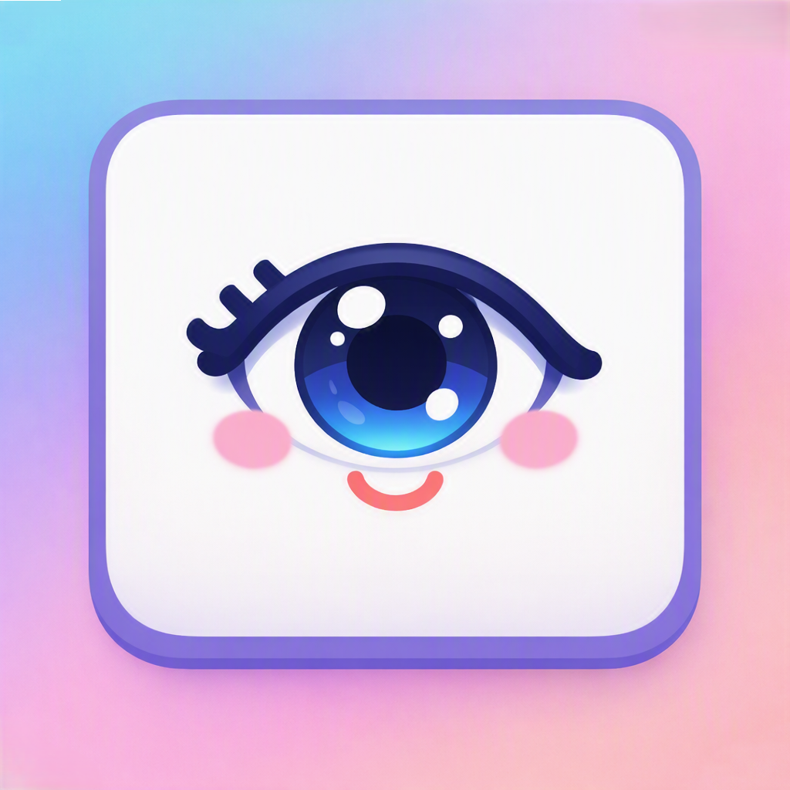

<p align="center">
  
</p>

# Rest Your Eyes

> **Prevención de fatiga visual y seguimiento de hábitos digitales con la regla 20-20-20.**

[English](README.md) | [Español](README.es.md)

[](https://kotlinlang.org/)
[-3DDC84?style=flat&logo=android&logoColor=white)](https://developer.android.com/)
[](https://developer.android.com/jetpack/compose)
[](docs/testing.md)
[](https://opensource.org/licenses/MIT)

Página del producto: [rest-your-eyes.ana-catalina.com](https://rest-your-eyes.ana-catalina.com)

---

## Descripción del Proyecto

**Rest Your Eyes** es una aplicación nativa para Android, offline-first y respetuosa con la privacidad, diseñada para combatir la fatiga visual provocada por el uso prolongado de dispositivos móviles. Aplica activamente la **regla clínica 20-20-20**: cada 20 minutos de uso continuo de pantalla, recuerda al usuario apartar la vista hacia un punto a 6 metros (20 pies) de distancia durante 20 segundos para relajar los músculos ciliares de los ojos.

La aplicación opera discretamente en segundo plano como un Foreground Service de Android, monitoreando el tiempo real de pantalla activa y reiniciando el temporizador si la pantalla se apaga. Al cumplirse el intervalo, muestra una pantalla superpuesta con cuenta regresiva, vibración opcional y un panel de seguimiento de cumplimiento de hábitos.

### Características Principales

- **Detección Continua de Uso de Pantalla:** Mide con precisión el tiempo ininterrumpido mediante broadcasts del sistema (`ACTION_SCREEN_ON` y `ACTION_SCREEN_OFF`), eliminando falsos positivos cuando el dispositivo está bloqueado.
- **Superposición de Pantalla Completa:** Cuenta regresiva relajante de 20 segundos con indicadores circulares de progreso y refuerzo positivo al completar el descanso.
- **Métricas de Cumplimiento de Descanso:** Registra pausas cumplidas vs. omitidas en dos horizontes temporales:
  - **Ventana Semanal Móvil:** Vista rodante de 7 días (`[hoy - 6 .. hoy]`) que evita reinicios abruptos en lunes por la mañana.
  - **Histórico de 180 Días:** Retención a largo plazo con poda automática de registros antiguos.
- **Microcopy Empático y Motivacional:** Métricas visuales no punitivas, porcentaje de efectividad visual y mensajes dinámicos de refuerzo de hábitos.
- **Intervalos y Preferencias Configurables:** Controles deslizantes para tiempos de trabajo (1-60 min) y descanso (5-60 seg), con vibración táctil y cierre automático opcional.
- **Reinicio Seguro:** Diálogo modal de confirmación (`AlertDialog`) que protege el historial contra borrados accidentales.

### Estructura de Componentes

La aplicación sigue la Arquitectura Moderna de Android (MVVM) respaldada por corrutinas y flujos reactivos de Kotlin:

| Componente | Responsabilidad | Referencia |
| :--- | :--- | :--- |
| **`EyeRestService`** | Servicio en primer plano persistente que escucha eventos de pantalla y agenda los descansos. | [`docs/architecture.md`](docs/architecture.md) |
| **`StatsRepository`** | Persistencia reactiva en DataStore que gestiona métricas diarias con retención de 180 días. | [`docs/external-references/break-stats-architecture.md`](docs/external-references/break-stats-architecture.md) |
| **`SettingsRepository`** | DataStore Preferences para intervalos de trabajo, duración del descanso y alertas. | [`docs/architecture.md`](docs/architecture.md) |
| **`OverlayActivity` / Screen** | Pantalla superpuesta Compose protegida por barrera atómica para registro único de eventos. | [`docs/learning/android-architecture-decisions.md`](docs/learning/android-architecture-decisions.md) |
| **`SettingsScreen`** | Panel principal de ajustes, gestión de permisos y analíticas de cumplimiento visual. | [`docs/architecture.md`](docs/architecture.md) |

### Stack Tecnológico

- **Lenguaje y Entorno:** Kotlin (Target JVM 17, Extensión de Compilador Compose 1.5.0)
- **Framework de UI:** Jetpack Compose con Material Design 3
- **Persistencia de Datos:** Jetpack DataStore (Preferences)
- **Asincronía y Estado:** Kotlin Coroutines (`Flow`, `StateFlow`)
- **Pruebas Automatizadas:** JUnit 4, Mockito Core
- **Sistema de Compilación:** Gradle Kotlin DSL (`minSdk = 26`, `targetSdk = 34`)

### Compilación y Ejecución

#### Requisitos Previos
- Android Studio Iguana (2023.2.1+) o superior
- JDK 17
- Android SDK con API nivel 34

#### Compilación Local
```bash
# Clonar el repositorio
git clone https://github.com/AnaCataVC/rest-your-eyes.git
cd rest-your-eyes

# Ejecutar pruebas unitarias
./gradlew testDebugUnitTest

# Compilar APK de depuración
./gradlew assembleDebug
```

El APK resultante se genera en `app/build/outputs/apk/debug/app-debug.apk`.

### Pruebas Automatizadas

Para ejecutar la suite completa de pruebas unitarias:
```bash
./gradlew testDebugUnitTest --rerun-tasks
```

Las pruebas cubren resiliencia de serialización, cálculo de cumplimiento semanal rodante, poda histórica y receptores de pantalla con 100% de éxito.

### Decisiones de Arquitectura y Aprendizajes

1. **Serialización Compacta en DataStore vs. Room SQLite:** Almacenar 180 días de contadores diarios representa aproximadamente 2.1 KB de datos. Integrar Room SQLite habría añadido 300-500 KB al APK, ralentizado los builds con KSP y requerido migraciones de esquema. Un serializador compacto delimitado (`epochDay:completed:skipped;...`) en DataStore Preferences se procesa en < 1 ms, no requiere librerías externas y es inmune a la ofuscación de reflexión de R8/ProGuard.
2. **Ventana Móvil de 7 Días vs. Semana Calendario Fija:** La agregación métrica emplea una ventana rodante de 7 días (`[currentEpochDay - 6 .. currentEpochDay]`) rotulada como *"Últimos 7 días"* en lugar de una semana fija ISO (lunes a domingo). Esto elimina el fenómeno del "lunes a cero", ofreciendo continuidad motivacional sin importar el día de la semana.
3. **Barrera Atómica de Idempotencia en el Overlay:** En Android, los overlays pueden cerrarse imprevistamente por gestos del sistema, llamadas entrantes o bloqueo de pantalla. Un guardián `AtomicBoolean` en `OverlayActivity` asegura que cada sesión registre exactamente un resultado terminal (`COMPLETED` o `SKIPPED`), evitando conteos duplicados en recomposiciones de Compose y eventos del ciclo de vida (`onStop`).

---

## Licencia

Este proyecto está bajo la Licencia MIT. Consulta el archivo [LICENSE](LICENSE) para más detalles.
