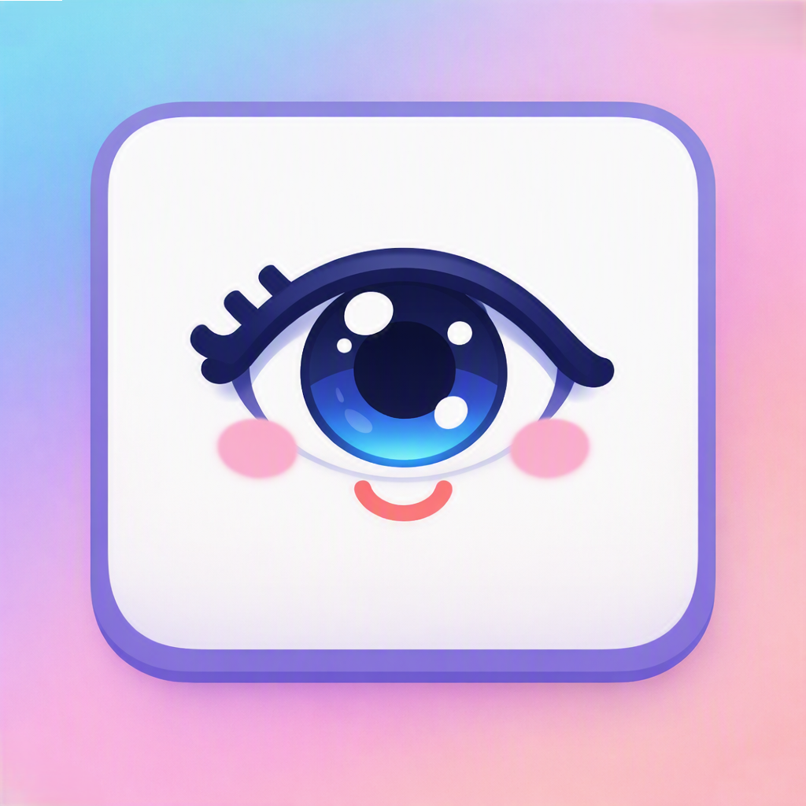

<p align="center">
  
</p>

# Rest Your Eyes

> **Digital eye strain prevention and visual habit tracking following the 20-20-20 rule.**

[English](README.md) | [Español](README.es.md)

[](https://kotlinlang.org/)
[-3DDC84?style=flat&logo=android&logoColor=white)](https://developer.android.com/)
[](https://developer.android.com/jetpack/compose)
[](docs/testing.md)
[](https://opensource.org/licenses/MIT)

Product page: [rest-your-eyes.ana-catalina.com](https://rest-your-eyes.ana-catalina.com)

---

## Project Description

**Rest Your Eyes** is an offline-first, privacy-friendly native Android application engineered to combat digital eye fatigue caused by prolonged screen usage. It actively implements the clinical **20-20-20 rule**: every 20 minutes of continuous screen activity, the user is reminded to shift focus to a point at least 6 meters (20 feet) away for 20 seconds to relax ciliary ocular muscles.

Operating unobtrusively as an Android Foreground Service, the app monitors real continuous screen engagement, resetting the timer when the screen turns off. When the interval is reached, it displays an overlay countdown accompanied by optional vibration and comprehensive habit compliance tracking.

### Key Features

- **Continuous Screen Usage Detection:** Accurately tracks uninterrupted screen time via system broadcasts (`ACTION_SCREEN_ON` and `ACTION_SCREEN_OFF`), eliminating false positives when the device is locked.
- **Full-Screen Break Overlay:** Presents a calm, non-intrusive 20-second countdown with animated progress indicators and positive reinforcement.
- **Visual Break Adherence Analytics:** Tracks completed vs. skipped breaks across two distinct time horizons:
  - **Weekly Rolling Window:** Dynamic 7-day rolling view (`[today - 6 .. today]`) avoiding artificial "Monday morning zero" resets.
  - **180-Day Historical Trend:** Long-term compliance retention with automatic pruning.
- **Empathetic Feedback & Microcopy:** Non-punitive visual metrics, compliance percentage calculation, and dynamic motivational microcopy.
- **Configurable Intervals & Preferences:** Granular sliders for work intervals (1-60 min) and break durations (5-60 sec), with optional vibration alerts and automatic dismissal.
- **Safe Reset Action:** Modal confirmation dialog protecting historical compliance data from accidental deletion.

### Architecture Overview

The application follows Modern Android Architecture (MVVM) backed by reactive Kotlin Coroutines and Flows:

| Component | Responsibility | Reference |
| :--- | :--- | :--- |
| **`EyeRestService`** | Persistent foreground service monitoring screen state broadcasts and scheduling timers. | [`docs/architecture.md`](docs/architecture.md) |
| **`StatsRepository`** | Reactive DataStore persistence managing daily compliance metrics with 180-day retention. | [`docs/external-references/break-stats-architecture.md`](docs/external-references/break-stats-architecture.md) |
| **`SettingsRepository`** | DataStore Preferences managing work intervals, break duration, and alert triggers. | [`docs/architecture.md`](docs/architecture.md) |
| **`OverlayActivity` / Screen** | Full-screen Compose overlay guarded by an atomic idempotency barrier for event registration. | [`docs/learning/android-architecture-decisions.md`](docs/learning/android-architecture-decisions.md) |
| **`SettingsScreen`** | Primary settings dashboard, permission management, and habit compliance analytics. | [`docs/architecture.md`](docs/architecture.md) |

### Tech Stack

- **Language & Runtime:** Kotlin (JVM 17 Target, Kotlin Compiler Extension 1.5.0)
- **UI Toolkit:** Jetpack Compose with Material Design 3
- **Data Persistence:** Jetpack DataStore (Preferences)
- **Asynchrony & State:** Kotlin Coroutines (`Flow`, `StateFlow`)
- **Testing:** JUnit 4, Mockito Core
- **Build System:** Gradle Kotlin DSL (`minSdk = 26`, `targetSdk = 34`)

### Getting Started

#### Prerequisites
- Android Studio Iguana (2023.2.1+) or newer
- JDK 17
- Android SDK with API Level 34

#### Build and Run Locally
```bash
# Clone the repository
git clone https://github.com/AnaCataVC/rest-your-eyes.git
cd rest-your-eyes

# Compile and run unit test suites
./gradlew testDebugUnitTest

# Assemble debug APK
./gradlew assembleDebug
```

The resulting debug APK will be generated at `app/build/outputs/apk/debug/app-debug.apk`.

### Automated Testing

To run the automated unit test suite:
```bash
./gradlew testDebugUnitTest --rerun-tasks
```

All repository tests cover serialization resilience, rolling weekly compliance calculation, historical pruning, and screen broadcast listeners with 100% passing rates.

### Key Learnings & Architectural Decisions

1. **Lightweight DataStore Serialization vs. Room SQLite:** Storing 180 days of daily break counters represents approximately 2.1 KB of data. Integrating Room SQLite would have added 300-500 KB to the APK, introduced KSP code-generation overhead, and required database schema migration logic. Implementing a compact delimited serializer (`epochDay:completed:skipped;...`) in DataStore Preferences parses in < 1 ms, requires zero external dependencies, and is completely immune to R8/ProGuard reflection obfuscation.
2. **Rolling 7-Day Window vs. Fixed Calendar Week:** Metric aggregation uses a dynamic rolling 7-day window (`[currentEpochDay - 6 .. currentEpochDay]`) labeled as *"Últimos 7 días"* instead of a rigid Monday-to-Sunday ISO week. This prevents the "Monday morning zero" phenomenon, ensuring continuous reinforcement of user habits regardless of the day of the week.
3. **Atomic Overlay Idempotency Barrier:** In Android, overlays can be interrupted by system back gestures, incoming phone calls, home button presses, or auto-dismiss timeouts. Using an `AtomicBoolean` guard in `OverlayActivity` ensures every break session records exactly one terminal outcome (`COMPLETED` or `SKIPPED`) without race conditions or duplicate counts across Compose recompositions and Activity lifecycle events (`onStop`).

---

## License

This project is licensed under the MIT License. See [LICENSE](LICENSE) for details.
